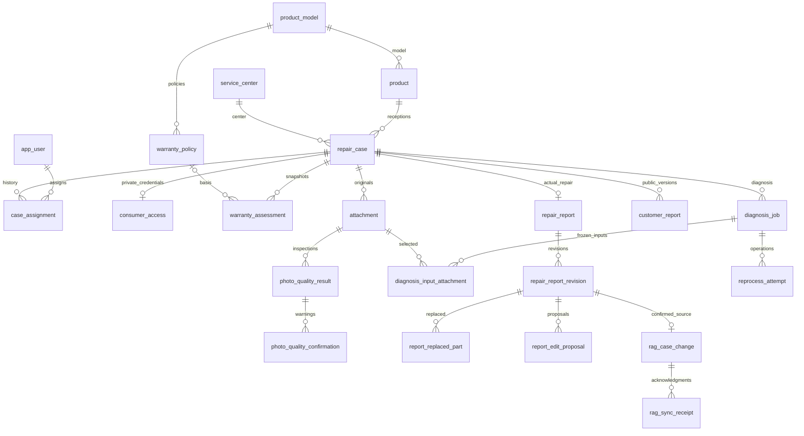

# V2 데이터 구조

기존 핵심 테이블은 보존하고 V8에서 확장한다. 소비자 개인정보·고객 공개본·RAG 검색용 데이터를 분리한다.

V8 신규10테이블: consumer_access, warranty_policy, warranty_assessment, case_assignment, customer_report, report_replaced_part, rag_case_change, rag_sync_receipt, report_edit_proposal, reprocess_attempt.

기존 확장: app_user.operations_enabled; repair_case.intake_source/service_type/purchase_date/assigned_technician_id 및 소비자용 nullable technician_id; attachment.uploader_id nullable; product_model.appliance_type; outbox_event.terminal_failure/last_error_code; received_event.original_disposition; agent_execution에 SURFACE 허용(과거 MOTOR/SW 보존).

고객 조회 키는 consumer_access.key_hash로 저장하며 보고서·Kafka·RAG에 넣지 않는다. 실제 교체 부품은 보고서 revision 단위이며 빈 목록을 허용한다. 고객 공개본은 별도 version이며 접수별 PUBLISHED를 최대1개로 제약한다. RAG 문서는 report/revision당1개이고 documentId는 report ID로 고정한다. 수동 재처리 이력은 original_event_id와 request_key로 연결한다.
